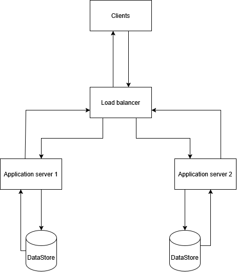

# Task A: Configuration and Results

## Task coverage

1. **Architecture:** the initial two-server design is shown below.
   
2. **Configuration:** the baseline settings are recorded below.
3. **Manual test:** the baseline was started with `node MainTerminal.js` and
   tested with local requests.
4. **Request simulation:** `RequestSimulation.js` sent 20 requests at each of
   16 intervals (320 requests per run).
5. **Evaluation:** baseline and two algorithm alternatives are measured below.
6. **Five additional configurations:** only two alternatives (Configs 2 and 3)
   have been measured so far; three more configurations still need to be run to
   complete this task.
7. **Hundreds, thousands, millions:** these scales were not tested by this
   320-request local testbed. Any discussion of them is architectural
   extrapolation, not measured evidence.

## Test configuration

| Setting | Value |
|---|---:|
| Load-balancing algorithm | Round Robin |
| Servers | 2 |
| Replicas | 2 |
| Sessions per server (min–max) | 5–10 |
| Processing time (min–max) | 100–300 ms |
| Datastores | 2 |
| Datastore capacity (configured range) | 2,000–3,000 |
| Request payload (configured range) | 1–20 |

Processing time is measured in milliseconds in the code. Datastore and payload
units are testbed values; the source comments do not reliably describe their
units. Server processing times, datastore capacities, and payload sizes are
randomized, so results can vary between fresh runs.

## Measured configurations

`RequestSimulation.js` sends 20 requests at each interval from 500 ms down to
1 ms: 320 requests total. Each configuration was started with a fresh
load-balancer process.

| Config | Settings changed from baseline | Successes | Failures | Success rate |
|---|---|---:|---:|---:|
| 1. Baseline | Round Robin; 2 servers | 186/320 | 134/320 | 58.1% |
| 2. Least Connections | Algorithm only | 177/320 | 143/320 | 55.3% |
| 3. Consistent Hashing | Algorithm only | 181/320 | 139/320 | 56.6% |

**Interpretation:** Slower requests were mostly served; failures generally
increased as the sending interval shortened. Results are not expected to fall
perfectly at every step: each interval has only 20 requests, and server
processing times, datastore capacities, and request payload sizes are random.
The outputs can be irregular: for example, a run can show successes at 5 or
10 ms even when all 20 ms requests failed. This is not proof that sending faster
improves success. Each interval is a small sample, and random payload sizes,
processing times, concurrent session availability, and remaining datastore
space all affect the result. Datastore writes consume capacity permanently;
session slots can become free as earlier sessions finish.

Running the simulation again while the same load balancer remains active may
look more consistently unsuccessful as datastore space continues to be used,
but it is not guaranteed to produce a smoother or more linear pattern. It is a
different starting state, not a fair repeat. Restart `MainTerminal.js` before
each comparison; repeat fresh runs and compare overall rates if possible.

Denials can result from server session limits or insufficient datastore space.
Use the server status and denial messages to identify which occurred.

## Comparison conclusion

In these runs, Round Robin had the highest overall success rate (58.1%),
followed by Consistent Hashing (56.6%) and Least Connections (55.3%). The
differences are small and do not prove one algorithm is consistently better:
the testbed randomizes processing times, datastore capacities, and payload
sizes. All three handled the slower intervals well and had more failures during
the faster intervals. This is a preliminary comparison, not a complete Task 6
result: three additional configurations remain to be tested. Hundreds,
thousands, and millions of requests were not measured here; claims about those
scales should be presented as design proposals, not test results.
