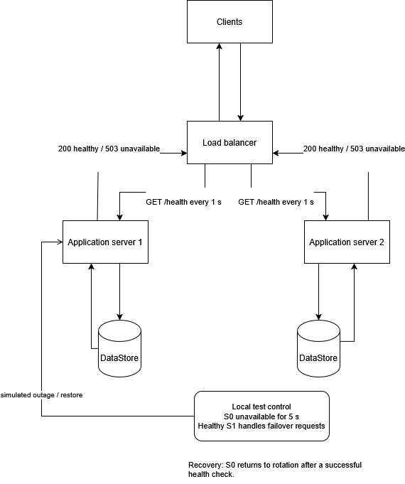

# Task B: Fault Tolerance and Abuse Defences

Both experiments were run against the local testbed. The updated Task B
architecture is shown below and saved as
[FCSDraftTwo.drawio.png](./Diagrams/FCSDraftTwo.drawio.png). The initial Task A
architecture is [FCSDraftOne.drawio.png](./Diagrams/FCSDraftOne.drawio.png).
Key code changes are marked `FAULT TOLERANCE` and `ABUSE DEFENCES`.

## B1. Fault tolerance

The load balancer checks backend `/health` endpoints every second. It avoids
unhealthy servers, retries a request on another healthy server, and returns a
recovered server to rotation after a successful health check.
`FaultToleranceSimulation.js` sends one request every 400 ms for 12 seconds and
simulates server `S0` being unavailable for 5 seconds.

| Result | Fault tolerance off | Fault tolerance on |
|---|---:|---:|
| Requests sent | 29 | 29 |
| Succeeded | 23 (79.3%) | 29 (100%) |
| Failed | 6 (20.7%) | 0 |
| Successes during the outage | 6/12 (50%) | 12/12 (100%) |
| Time to outage end / health-check recovery | 5.002 s outage; recovery not measured | 5.678 s until `S0` returned to rotation |

With failover enabled, the healthy backend served requests during the outage.
Health checks add traffic and recovery waited for the next check. This is a
small controlled test, not a production availability guarantee.

To repeat, start `MainTerminal.js` with `$env:FAULT_TOLERANCE = "off"` or `"on"`,
choose `Y`, then run `node FaultToleranceSimulation.js fault` in a second
terminal. Use the same configuration and restart between runs. The optional
`baseline` mode runs without injecting a failure.

## B2. Defences against abusive traffic

### Threat model and controls

| Simulated threat | Resource at risk | Defence |
|---|---|---|
| Burst of requests | Server sessions and datastore capacity | 5 requests per client IP per second |
| Oversized request body | Memory and request processing | 1,024-byte limit; HTTP 413 |
| Slow request or stalled backend | Open connections and server capacity | Request/header and backend timeouts |

`AbuseTrafficSimulation.js` sends 12 legitimate requests spaced 500 ms apart
and 14 local burst requests (8 oversized) for each run.

| Result | Defences off | Defences on |
|---|---:|---:|
| Legitimate requests served | 8/12 (66.7%) | 9/12 (75.0%) |
| Legitimate average latency | 5.5 ms | 5.2 ms |
| Abusive requests rejected by defences | 0/14 (0%) | 9/14 (64.3%) |
| Of those: oversized / rate-limited | 0 / 0 | 8 (HTTP 413) / 1 (HTTP 429) |
| Other abusive requests denied by server/datastore | 2 | 0 |
| Abusive average latency | 24.3 ms | 21.0 ms |

The results show early rejection of oversized and burst requests in this run.
CPU and memory were not measured, and timeouts were not deliberately triggered.
Only one run per mode was recorded, so the small latency and legitimate-success
differences are not proof of a general performance improvement.

The per-IP limit can also throttle legitimate clients. In this local test, all
requests share the loopback IP; a real deployment needs suitable client
identification and threshold tuning. The simulation is local only and does not
represent distributed or production-scale denial-of-service traffic.

To repeat, start the load balancer with `$env:ABUSE_DEFENCES = "off"` or `"on"`,
choose `Y`, then run `node AbuseTrafficSimulation.js` in a second terminal.
Restart between modes with the same configuration. If using an alternate port,
set the same `$env:PORT` in both terminals.
